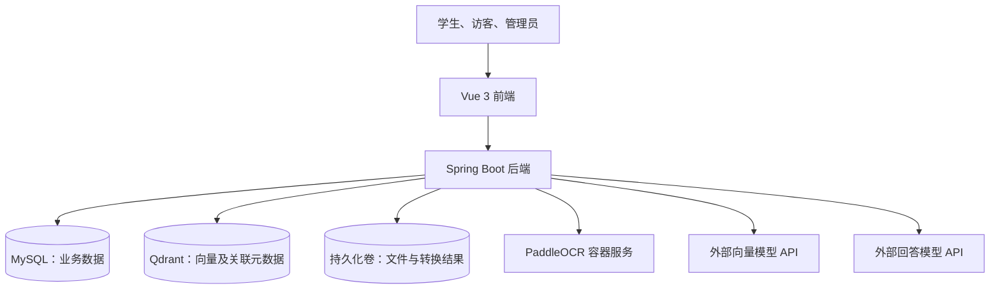

# 校易问系统架构

本文记录已确认的技术选择和组件职责。尚未确认的实现方式标记为待定，不代表相关环境已经安装或验证。

## 1. 设计依据与当前状态

- 业务范围见 `requirements.md`，访问规则见 `permissions.md`。
- 第一版仅围绕学生手册提供问答、依据查看，以及用户留言与管理员回复。
- 应用场景使用虚构院校“明序学院”。拟使用华东理工大学学生手册作为示例，保留真实来源，不将其冒充虚构院校的正式文件。
- 示例手册具体文件、版本及适用范围尚待核实。
- 用户选择暂时跳过技术验证：文档解析、OCR 转换、检索与回答质量均未验证。
- 本次仅编写架构文档，不编写应用代码、Dockerfile 或 Compose 配置，不安装或启动服务。

## 2. 已确认的组件

| 组件 | 技术选择 | 职责 |
|---|---|---|
| 前端 | Vue 3 | 学生问答与资料查看、账号相关交互、留言、管理员操作界面 |
| 后端 | Java + Spring Boot | 业务接口、身份及权限校验、文件管理、文档处理协调、问答协调、留言及审计 |
| 业务数据库 | MySQL | 保存账号、授权、文档与版本、处理及校验信息、留言和回复等业务数据 |
| 向量检索服务 | Qdrant | 保存文档片段向量及关联元数据，执行相似度检索 |
| 文件存储 | Docker 持久化卷 | 保存上传文件和转换结果；无需额外部署对象存储服务 |
| PDF 转换 | 本地部署的 PaddleOCR，容器化运行 | 接收后端协调的 PDF 转换任务，生成后续解析所需的 Markdown |
| 回答模型 | 外部 API | 根据问题和检索依据生成回答；具体服务商和模型待定 |
| 向量模型 | 外部 API | 将文档片段和用户问题转换为检索向量；具体服务商和模型待定 |

Qdrant 的选型依据是第一版围绕学生手册、希望减少初期容器部署组件。该选择未通过项目实测，不作为性能优于其他方案的结论。

## 3. 环境边界

- 前端、后端的开发、构建与运行工具，以及 MySQL、Qdrant、OCR 等服务均使用容器环境。
- 不依赖电脑本地安装的 Java、Maven、Node.js、Python 或数据库。
- 电脑仍需提供可用的 Docker 容器运行环境，容器使用宿主机的 CPU、内存、磁盘等资源。
- 项目后续保存环境构建与编排配置；当前不生成配置。
- 回答模型和向量模型使用外部 API，不在本机部署模型推理服务。
- 业务数据库、向量索引、上传文件和转换结果需要持久化，不能仅保存在容器临时文件系统。
- Docker 当前是否安装、是否可用尚未检查。

## 4. 组件关系

此图表达逻辑调用关系，不规定最终容器数量、端口、网络和部署拓扑。OCR 的具体调用协议及文件传递方式待定。

## 5. 数据职责

| 数据 | 归属 |
|---|---|
| 用户、角色及操作授权 | MySQL |
| 学生名单和绑定演示邮箱 | 业务数据；演示数据初始化方式待定 |
| 手册元信息、版本、发布状态、校验结论 | MySQL |
| 上传文件、转换后的 Markdown、留言附件 | Docker 持久化卷 |
| 用于检索的片段向量和文档关联标识 | Qdrant |
| 留言、管理员回复、管理操作审计 | MySQL |
| 片段正文、来源定位、在线修改版本 | 具体存储结构及与 Qdrant 的关联方式待定 |
| 问答历史 | 是否持久化、保存周期及历史访问细则待定 |

MySQL 中的业务状态与 Qdrant 索引需保持一致。具体同步、失败恢复、发布切换和彻底删除策略尚待设计，不能假定两者具有共同的数据库事务。

## 6. 手册导入与发布流程

1. 管理员提交文件，后端检查操作权限、文件格式和大小。
2. 支持 MD、DOCX、DOC、PDF；单文件不超过 100 MB，恰好 100 MB 允许上传。
3. PDF 由后端协调本地容器中的 PaddleOCR 转换为 Markdown；DOC、DOCX 提取正文，不经过 OCR；MD 进入后续解析。
4. 超过 100 MB 的文件在上传前人工处理，处理结果仍须符合格式和大小限制。人工将 PDF 转成 MD 时仅上传 MD，不上传原 PDF。
5. AI 初检仅标记乱码、疑似缺失或重复、章节条款不连续、格式异常等疑点，不自动修正规定；无论是否发现疑点，都交管理员复核。
6. 管理员可以在线修改解析正文，上传文件保持不变；修改后重新经过 AI 检查与人工复核。
7. 校验完成后，由具有发布权限的管理员手动发布。分块、向量化和索引就绪与发布动作的具体编排待定，未发布材料不能作为问答依据。
8. 已发布手册修改正文前必须停用；期间停止问答使用、学生预览、下载及引用访问。修改后重新检查、复核并手动发布。
9. 新版发布成功后旧版退出学生访问和问答，后台留存；仅上传新版不影响旧版。

在线修改正文、上传文件和转换结果必须能区分。人工转换版标注“转换版，未保存原文件”；系统不能提供未上传原 PDF 的访问入口，也不能编造其页码定位。

PaddleOCR 的具体发行组件、版本、Markdown 导出能力、运行资源，以及 DOC 的解析实现均需后续核验。当前只记录用户确认的技术方向，不宣称能力验证完成。

## 7. 问答流程与边界

1. 后端识别匿名或登录状态；匿名请求按 IP 每日计数，额度由授权管理员设置。
2. 调用外部向量模型将问题转换为向量。
3. 从有效、已发布且符合访问规则的手册范围中检索相关片段；具体检索策略、分块及过滤实现待定。
4. 将必要问题内容和获准依据交给外部回答模型生成答案；无依据时明确说明，不编造规定。
5. 匿名用户只能阅读概括性回答，不能获取引用片段或手册文件；请求逐字输出或分段输出手册时拒绝原文输出。
6. 已登录学生可以访问有效已发布手册的引用片段、预览和下载；停用或逻辑删除后不得继续访问。

原文展示权限与后台检索依据需要区分：匿名用户仍可获得制度内容的概括，不能仅靠隐藏按钮限制原文接口。具体答案约束与防止原文泄露的验证方案待定，不声称仅靠提示词可完全保证。

向量模型、向量维度和 Qdrant 集合配置需保持匹配；更换向量模型后的重建索引策略待定。

## 8. 身份、留言与审计的架构约束

- 学生通过预置演示名单中的学号、初始密码及绑定邮箱验证完成激活，不接入真实学校身份系统。
- 不强制改密；留言与附件提交额外要求已登录且完成改密。
- 部署时技术人员设置最高权限账号，由其分配其他管理员操作权限；不使用 IP 决定管理员身份。
- 后端执行操作和资源访问校验，前端展示限制不能替代后端校验。
- 禁用账号后禁止登录并立即终止已有登录状态；认证、会话与撤销机制待定。
- 留言附件支持 MD、TXT、DOCX、PDF，每条最多 3 个、每个不超过 10 MB。
- 每人每天最多成功提交 3 次留言，按北京时间零点重置，失败不计数；并发计数实现待定。
- 所有管理员可查看用户主动提交的留言和附件并选择回复，不能因此读取完整问答记录；学生仅能查看本人留言对应的回复。
- 管理操作记录审计，具体字段、保留期和查看权限待定。

## 9. 待确认的技术决策

| 事项 | 当前状态 |
|---|---|
| Java、Spring Boot、Vue、MySQL、Qdrant 及镜像版本 | 待定，后续核对兼容性并固定版本 |
| AI 接入框架 | 待定；尚未确认使用 Spring AI 或其他方案 |
| 回答、向量及 AI 初检使用的服务商和模型 | 待定；AI 初检具体调用方案未确认 |
| PaddleOCR 具体组件、CPU/GPU、模型文件准备 | 待核验 |
| DOC/DOCX 提取库、各格式预览方式 | 待定 |
| 后端模块组织 | 已确认采用模块化单体；账号权限、手册、问答、留言等业务在同一 Spring Boot 应用中分模块组织，具体依赖关系待设计 |
| 文档任务同步或异步、队列、超时与重试 | 待定；此前讲解示例不作为已确认实现 |
| 分块、检索、重排、引用校验和问答评估 | 待定，写入后续 RAG 设计 |
| 登录认证、密码存储、邮箱演示验证 | 待定 |
| 文件卷布局、备份与恢复 | 待定 |
| 匿名额度默认值、重置时区及可信 IP 获取 | 待定；与留言北京时间规则分别处理 |
| API 协议、流式响应、页面与数据模型 | 待定 |
| 网络入口、反向代理、端口、健康检查和启动顺序 | 待定 |
| 缓存、消息中间件等额外组件 | 未选定，不默认引入 |
| 模型密钥注入及外部 API 数据传输范围 | 具体方案待定；不在本文件填写真实密钥 |

## 10. 后续设计落点

- `data-model.md`：实体、关系、文档状态与数据一致性规则。
- `rag-design.md`：文档处理、分块、检索、模型调用、引用和评估。
- `api/openapi.yaml`：接口、参数、错误和鉴权约定。
- `ui-spec.md`：页面、交互与异常状态。
- `deployment.md`：已确认组件的容器运行、配置、持久化及维护方式。

以上仅说明后续文档的职责，不代表本次已经编写这些文档或批准全部实现细节。
